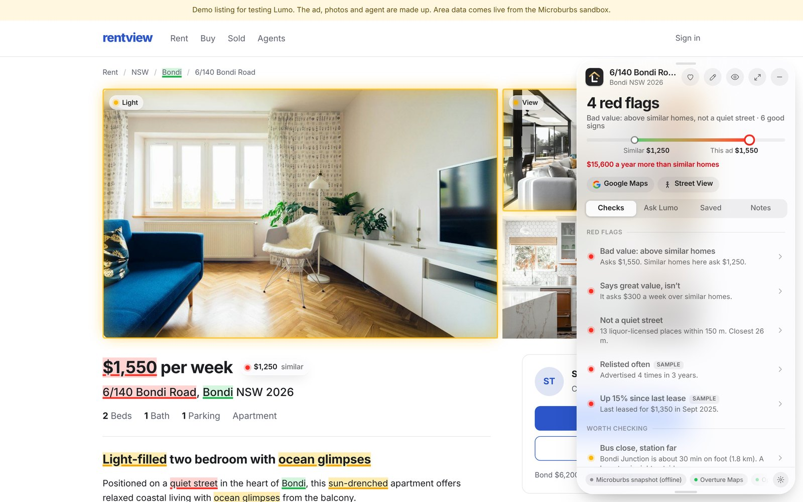
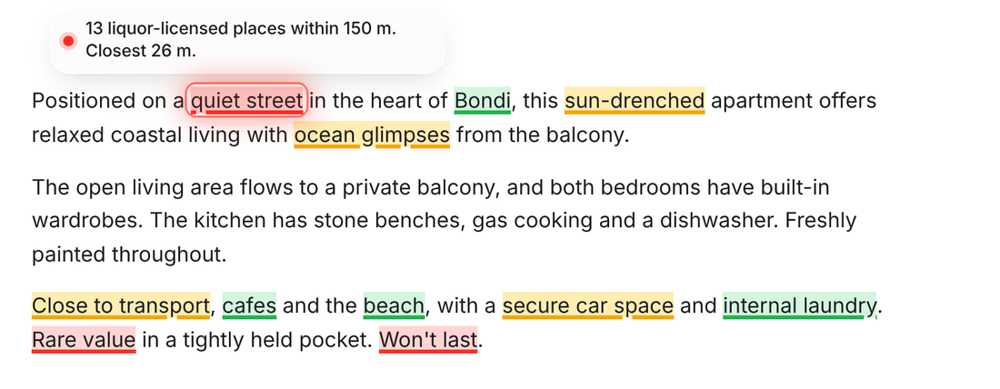
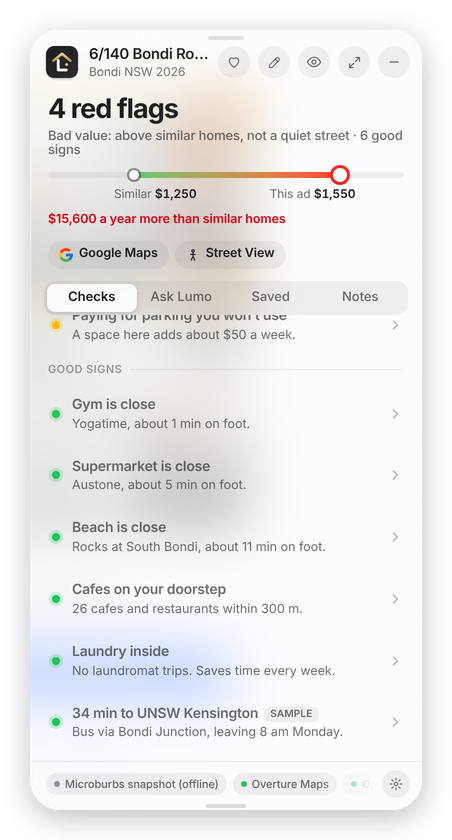
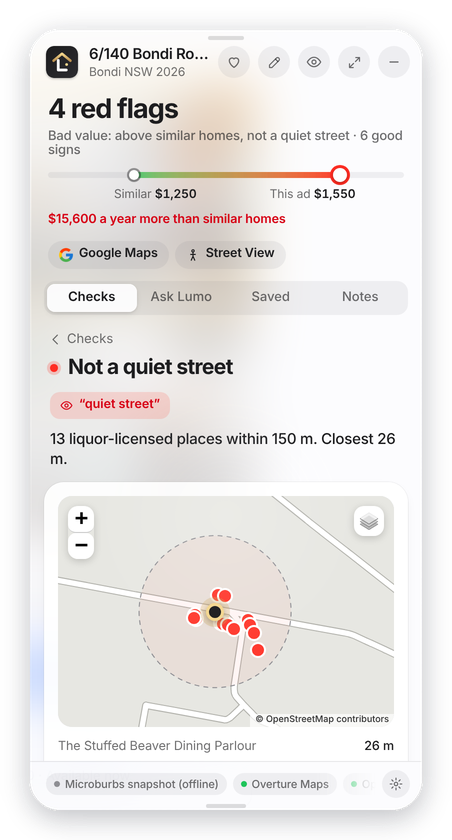
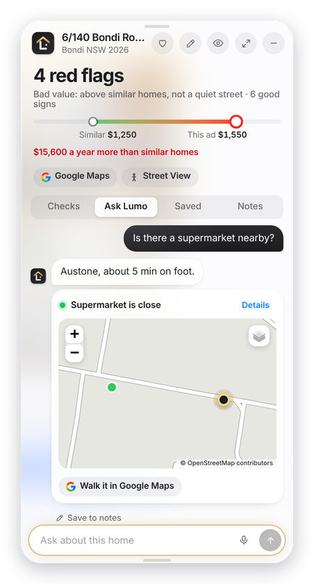
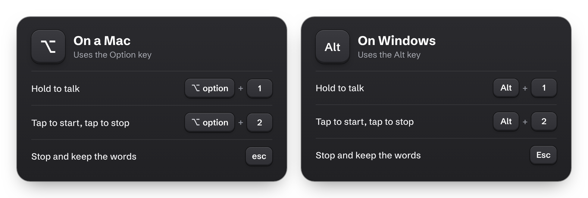
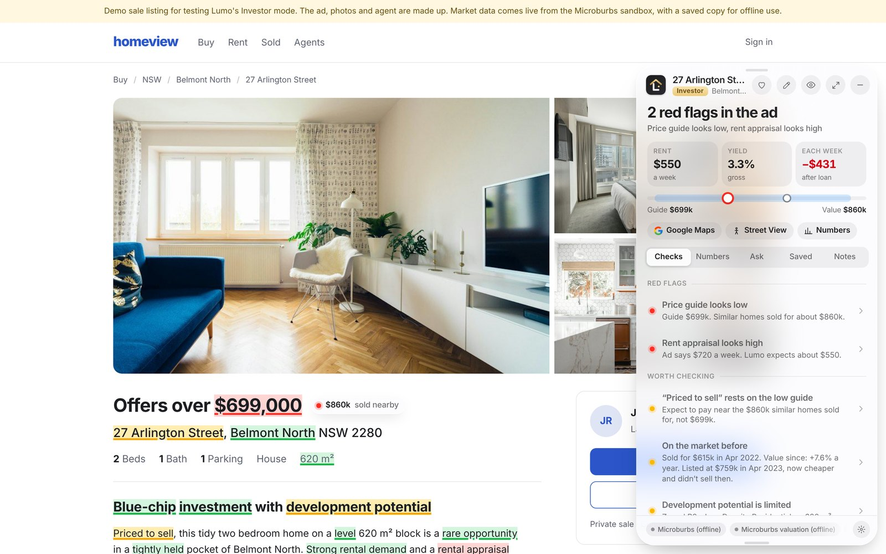
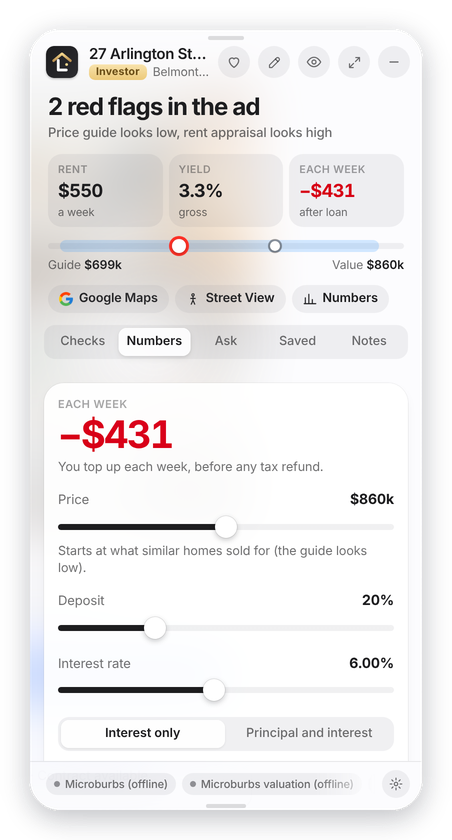
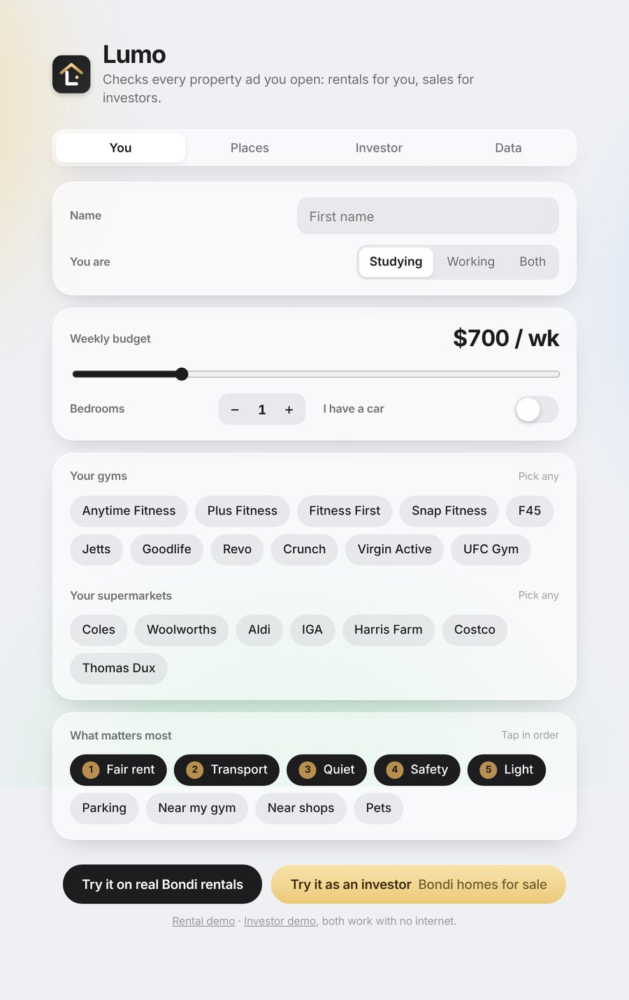

  

<h1 align="center">Lumo</h1>

  <b>Know any home in seconds.</b> 
  A Chrome extension that reads the property listing you're looking at and checks it against real data.

  <a href="#who-it-helps">Who it helps</a> ·
  <a href="#the-clever-step">The clever step</a> ·
  <a href="#how-it-works">How it works</a> ·
  <a href="#ask-lumo">Ask Lumo</a> ·
  <a href="#buying-instead-of-renting">Investor mode</a> ·
  <a href="#where-the-answers-come-from">Data</a> ·
  <a href="#get-started">Get started</a>

## Why Lumo

Property ads are written to sell. A listing says "quiet street" and "great value", and checking either claim means hours on maps, rent sites and council records. Most people skip that and find out after they've signed the lease.

Lumo does that research while you look at the listing. It opens beside any ad on Domain or realestate.com.au and answers the questions you'd normally have to dig for. Where's the nearest gym? Is there a supermarket close by? Is the rent fair? How far is the bus stop, and how long will it take to get to uni or work?

## Who it helps

Renters use Lumo to check a rental before they inspect it or apply. It's built for people who can't visit every suburb, like students looking for a place near uni or anyone moving to Sydney from somewhere else.

Buyers and investors use Investor mode on homes for sale. It checks the price guide against real sales, tests the rent the ad promises, and works out what the home would cost them each week.

## The clever step

Lumo treats the ad's own words as claims it can test. It keeps a list of 117 phrases agents use, grouped into 22 claims such as "quiet street", "close to transport", "tightly held" and "priced to sell". Each claim points to a check backed by Microburbs data and public data. "Quiet street" points to licensed venues near the home, and "close to transport" points to the walk to the nearest station. Lumo runs the check and pins the result onto those exact words on the page, so the evidence sits right where the claim is made.

Lumo reads the listing straight from the Domain or realestate.com.au page: the price, bedrooms, bathrooms, parking, the ad's words and the photos. It then runs its own checks on those details using Microburbs data.

For a rental, Lumo pulls the homes for rent right now in the same suburb with the same property type and number of bedrooms, and compares their rent with this one. For a home for sale, it pulls recent sales with the same bedrooms and bathrooms and compares them with the price guide. If those sales are homes that differ from this one, Lumo says so and doesn't call the price guide low.

Adding a new phrase is one line in a file, with no code to change.

## How it works

1. Open any listing on Domain or realestate.com.au. Lumo starts reading it straight away.
2. Words in the ad that make a claim get a coloured mark. Red means the data says otherwise, yellow means it's worth checking, and green means it's a good sign.
3. Hover over a mark to see why. Click it to see the proof.

  

## Everything in one panel

Click the Lumo button in the corner of the page and the panel opens beside the listing. The top shows the verdict and how the rent compares with similar homes nearby. Below that, every check is sorted into red flags, things worth checking and good signs.

<table>
  <tr>
    <td align="center" width="33%"></td>
    <td align="center" width="33%"></td>
    <td align="center" width="33%"></td>
  </tr>
  <tr>
    <td align="center">Your gym, supermarket and trip to uni, worked out for this home</td>
    <td align="center">Click any check for the proof, like a map of every licensed venue nearby</td>
    <td align="center">Ask a question and get a straight answer about this home</td>
  </tr>
</table>

You can also heart a home to save it with all its checks, and add notes as you go, like what the agent told you at the inspection.

## Ask Lumo

Type a question, or say it out loud. Your words appear in the chat box as you speak, and nothing is sent until you press Enter.

  

Things you can ask:

- Where's the nearest bus stop?
- Is there a supermarket nearby?
- Is the rent fair?
- How long will it take me to get to uni?

Lumo answers from its checks and the data it found for that home. If you add an AI key ([see below](#optional-ai-answers)), the answers are written by the AI and can use your notes too.

## Buying instead of renting?

Open a home for sale and Lumo switches to Investor mode.

Lumo works out what the home is likely worth from similar homes that sold nearby, what rent it could earn, and what it would cost you each week after the loan. Then it tests the ad against those numbers. In this example the ad says "offers over $699,000", but similar homes sold for about $860,000, so the price guide looks low. The ad also promises $720 a week in rent, where Lumo expects about $550.

It checks the usual sales lines too, like "priced to sell", "tightly held" and "development potential", against past sales, the zoning and approved plans nearby.

<table>
  <tr>
    <td width="45%" align="center"></td>
    <td width="55%">
      <h3>Try your own numbers</h3>
      
Open the Numbers tab and drag the price, deposit and interest rate, or switch between interest only and principal and interest. Every figure updates as you go: what you'd pay or earn each week, your yield after costs, and the cash you need to buy, including NSW stamp duty.

      
Lumo shows you the numbers and leaves the decision to you. It isn't financial advice.

    </td>
  </tr>
</table>

## Where the answers come from

Every check names its source, so you can see where each number came from. When Lumo doesn't have the data for something, the check says "not checked yet".

| Source | What Lumo uses it for |
|---|---|
| Microburbs | Rents and sales of similar homes, valuations, rent history, crime, flood risk, days on market |
| NSW Planning Portal | Building work and approved plans near the home |
| NSW Spatial Services | Nearest train station, and which council the home is in |
| ABS Census 2021 | Local incomes and rents |
| City of Sydney open data | Street lights, street trees and late night trading streets |
| OpenStreetMap and Overture Maps | Gyms, supermarkets, cafes, pubs and walking routes |
| Google Maps | Your commute and Street View |

## Your privacy

- Lumo only reads the listing you have open. It doesn't open or scrape other listings.
- Your profile, saved homes and notes are stored in your browser, on your computer.
- If you add an AI key, your question is sent to that AI company along with this home's details, its checks and your notes.
- Any keys you add stay in the Lumo folder on your computer.

## Get started

Lumo isn't on the Chrome Web Store yet, so you add it to Chrome yourself. It takes about two minutes.

<table>
  <tr>
    <td width="55%">
      <ol>
        <li>Click the green <b>Code</b> button at the top of this page, choose <b>Download ZIP</b>, then unzip it.</li>
        <li>In Chrome, go to <code>chrome://extensions</code> and turn on <b>Developer mode</b> in the top right corner.</li>
        <li>Click <b>Load unpacked</b> and choose the <code>lumo</code> folder inside the one you unzipped. It's the folder with <code>manifest.json</code> in it.</li>
        <li>Lumo's setup page opens. Set your budget, pick your gym and supermarket, and add the places you go each week, like uni or work.</li>
        <li>Pin Lumo to your toolbar and open any rental on Domain. To see it straight away, click the first <b>Try it</b> button on the setup page.</li>
      </ol>
      
The setup page also has a Rental demo and an Investor demo, with made up listings to try it on.

    </td>
    <td width="45%" align="center"></td>
  </tr>
</table>

With the free key that comes with Lumo, Microburbs data covers a few test suburbs. A Microburbs hackathon key adds the City of Sydney's 29 suburbs. The public data in the table above works across Sydney.

### Optional: AI answers

Lumo answers from its own checks out of the box. For answers written by an AI:

1. In the `lumo` folder, make a copy of `.env.example` and name it `.env`. On a Mac, Finder hides files that start with a dot, so press Cmd + Shift + . to show them.
2. Paste an Anthropic, Google Gemini or OpenAI key after `LLM_API_KEY=` and save the file.
3. In `chrome://extensions`, click the reload arrow on Lumo.

A Microburbs hackathon key goes in the same file, after `MICROBURBS_KEY=`.

## For developers

How Lumo is built, the full list of checks and how to add a new data source are in [lumo/README.md](lumo/README.md).

Built by Muhammad Aayan, Uday Saihgal and Sameer Singh.

