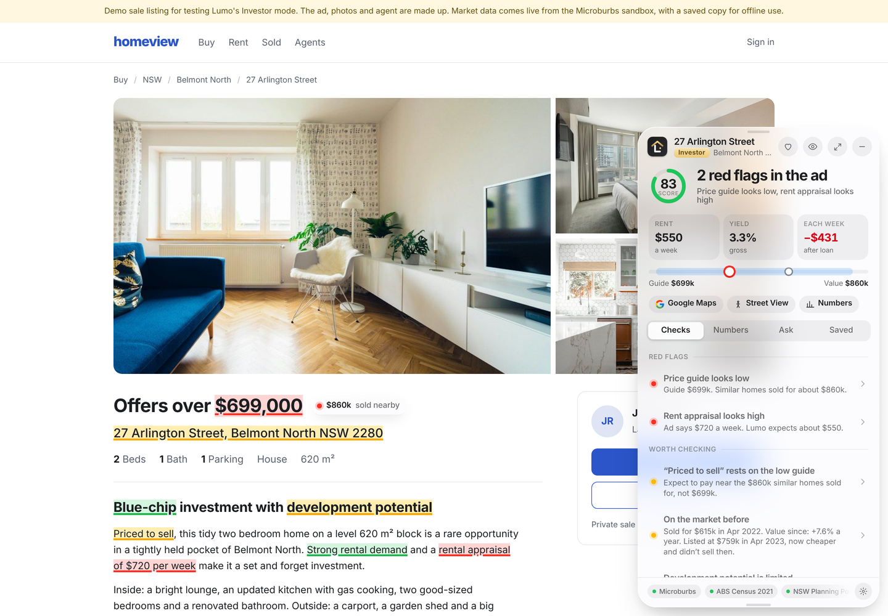
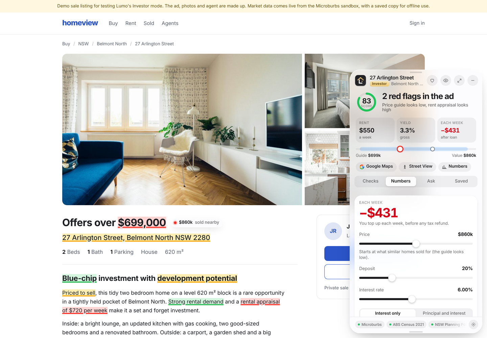

# Lumo

A Chrome extension that reads the property ad you're looking at and checks what it claims. On a rental it works for the renter. On a home for sale it switches to **Investor mode**.

Open a listing on Domain or realestate.com.au and Lumo wakes up. It finds the words that make claims ("quiet street", "close to transport", "light-filled", "rare value") and tests them against real data. The words get a soft red, amber or green mark that stays on the text as you scroll. When a problem is about a photo, only the photo's edges glow. Hover a mark for one line. Click it for the proof, what it means, the next step and questions Lumo answers itself.

Microburbs Hackathon, Task 3: show Microburbs facts beside the listing a buyer is viewing. Its fair-rent check and Investor mode's rent estimate are built to take your Task 4 rent model.

## Install (2 minutes)

1. Open `chrome://extensions` and turn on **Developer mode** (top right).
2. Copy `lumo/.env.example` to `lumo/.env` and fill in the keys you have (see **Keys** below). Lumo still runs with an empty file.
3. Click **Load unpacked** and pick this `lumo` folder.
4. The setup page opens. Fill in You and Places (30 seconds).
5. Click **Try it on real Bondi rentals** and open any listing. Bondi works on the free key; your Microburbs key unlocks every suburb.

Pin Lumo to the toolbar. Clicking the icon opens or closes the panel. On a page that isn't a listing, it opens real Bondi rentals on Domain.

### Keys

Every API key lives in `lumo/.env`, which git ignores. `lumo/.env.example` shows the layout: `LLM_API_KEY`, `LLM_MODEL`, `LLM_ENDPOINT`, `MICROBURBS_KEY` (`test` = the free sandbox), `GOOGLE_MAPS_KEY`, `TFNSW_KEY`, `MAPILLARY_TOKEN`. After editing it, reload Lumo in `chrome://extensions`. Settings → Data shows which keys are loaded, never their values. Anyone with the extension folder can read the file, so don't share a build that has real keys in it.

### Voice

On a listing, ask Lumo out loud. The panel opens on the chat tab and your words are typed into the chat box as you speak. Nothing is sent until you press Enter.

| Keys | What it does |
|---|---|
| ⌥1 (hold) | Push to talk: listens while you hold the keys. |
| ⌥2 (tap) | Tap to start, tap again to stop. It doesn't stop by itself when you pause. |
| Esc | Stops listening and keeps the words. |
| Mic button | Same as ⌥2. |

If Lumo hasn't read the page yet, a shortcut starts the scan and listens straight away; a question sent before the checks finish is answered when they're ready. The first time, Lumo opens an **Allow microphone** tab: allow it once and it works on every listing site. You can open the same tab from Settings → Data → **Enable microphone**, and change both shortcuts there. Speech recognition is Chrome's own (`en-AU`) and needs internet access. Lumo doesn't speak its answers.

Tested on live Domain listings, to rent and for sale (Nov 2026): price or price guide, beds, baths, parking, description, features, coordinates and photos are read from the page's own data. On Domain, "rent or buy" comes from the listing's `mode` ("buy" / "rent"); its `listingType` says "rent" even on homes for sale, so Lumo doesn't trust it. realestate.com.au is read from its embedded listing data, and if that changes, from the tab title ("House for Sale"), the price line and the summary strip. It couldn't be opened from the test browser, so check one listing there yourself.

With the free `test` key, Investor mode on a real ad works in sandbox suburbs (Bondi and a few others) from suburb data: similar sales, rentals for rent now, yield, growth, vacancy, supply. Lumo finds the home in the suburb's own listings to get its location. Your hackathon key adds this home's valuation, sale history and land value. When the value rests only on suburb sales of homes unlike this one (different bathrooms, no valuation), Lumo says so and won't call it underquoting.

## Investor mode (homes for sale)



Open a listing **for sale** and Lumo checks it the way an investor would. The panel shows a gold **Investor** badge and:

| Piece | What it does |
|---|---|
| Score ring | One number out of 100: price, rent return, growth, risk and tenant demand, weighted. The breakdown is in Numbers. |
| Key numbers | Rent a week, gross yield, and what it costs (or pays) each week after the loan. |
| Value meter | The ad's price or guide against Lumo's value, with the Microburbs valuation range as a band. |
| Checks | The ad's claims tested against data, from `knowledge/investor-traps.md`: a low price guide (underquoting), a high rent appraisal, "priced to sell", "strong rental demand", "tightly held", "blue-chip", "development potential" against the zoning, pressure words, sale history, approved plans on the lot, supply nearby, investor-heavy areas, strata, bushfire and flood. |
| Numbers | A live calculator. Drag price, deposit and interest rate, or switch interest only / principal and interest, and every figure updates: money in and out each week, yield after costs, cash to buy with NSW stamp duty, the score breakdown and suburb growth. Your deposit, rate and loan type are remembered for every home. |
| Ask | Answers about value, rent, holding cost, cash to buy, growth, supply, strata, land and the score. |



How the numbers are made:

- **Value**: the middle of the Microburbs valuation (AVM), similar homes sold in the last year (same kind and bedrooms, from suburb sales and nearby sales), and the suburb median for that many bedrooms.
- **Rent**: your Task 4 model if connected, else the median of similar homes for rent now, else the suburb yield applied to the value.
- **Price used in the sums**: the asking price, the middle of a range, or the guide. If the guide sits well under the value, Lumo uses the value and says so, because that's what the home will likely sell for.
- **Costs**: strata from the ad or the suburb median, council and water rates from the ad if stated, otherwise typical figures; landlord insurance, a 7% manager plus a week to let, empty weeks from the suburb vacancy rate (at least one week), repairs, and NSW land tax if the land value is over the threshold. Each cost says where it came from.
- **Stamp duty**: NSW transfer duty at 2026–27 rates. **Land tax**: NSW 2026 thresholds. Not financial advice.

Change the defaults in Settings → Investor.

## What you see (rentals)

| Piece | What it does |
|---|---|
| The beam | When an ad opens, a soft light passes down it and each flagged word lights up as it's reached. |
| Dock (bottom right) | Beam logo and red/amber/green counts. Says the verdict once ("4 red flags"). Drag it anywhere; it remembers where. Click to open. |
| Text marks | The ad's own words: red for problems, yellow to check, green for good things. Painted into the page's text, so they stay exactly on the words when you scroll. Every red, yellow and green check in the panel has a mark in its own colour: a claim word if the ad makes one, otherwise a topic word ("garage" for parking, "station" for transport), the facts strip ("2 Parking"), the suburb's name for area checks, the street for this home, or the price. Lumo opens the ad's "Read more" first, so no mark hides in the folded part. |
| Price note | A small note pinned beside the price: what similar homes ask. |
| Photo edges | A thin glowing edge on the photo the problem is about, with a small tag. |
| Hover bubble | One line of glass: "13 licensed venues within 150 m. Closest 26 m." |
| Panel | Verdict, asking rent against similar homes and the yearly difference, Google Maps and Street View, then Checks, Ask Lumo and Saved. Drag it by the top bar. The minus button folds it back into the dock. The eye hides all marks for a clean page. |
| Your places | Time to uni or work from every listing, hours a week, and a button that opens the trip in Google Maps. |
| Check detail | The quote from the ad, proof (a mini map, bars or rent history), what it means, next step, follow-up questions. |
| Ask Lumo | Chat about this home, typed or spoken (⌥1 / ⌥2). Answers come from an LLM using the knowledge files and the checks. With no LLM key in `.env`, it replies "Insert key". |
| Saved | Heart a home to keep it with its checks: the swipe shortlist, inside the browser. |
| Settings | Your profile (budget, car, gym, supermarket, what matters), places, Renter ID card, which `.env` keys are loaded, microphone and voice shortcuts. |

## Data and APIs

Lumo uses free government and open data alongside Microburbs, so it works on any Sydney listing, not only the suburbs the free Microburbs key covers. The full list, with how each is reached, is in `knowledge/data-sources.json`.

| Source | How | What it checks |
|---|---|---|
| Microburbs API | live | fair rent from similar listings, car space value, late venues, crime vs national, flood, days on market, rent history and relisting (with a full key) |
| Microburbs API (Investor mode) | live | valuation (AVM), sale history, recent and nearby sales, land value and zoning, median sale price, yield, price growth and forecast, vacancy, months of supply, stock, strata levies, investor share, agent quoting (full key only) |
| NSW Planning Portal: online DA data (since 2019) | live | building work within 300 m, views at risk, construction noise, demolition and rebuilds |
| NSW Spatial Services (NSW Government) | live | nearest station, night walk start point, which council (for DA data) |
| ABS Census 2021 | live | median rent 2021, household and personal income, people per bedroom, rent as a share of local income |
| City of Sydney open data | live | council street lights on the night walk, street trees within 100 m, late-night trading streets |
| OpenStreetMap | live + bundled | walking routes, street lights and lit streets, pubs and bars, stations, gyms and supermarkets by brand |
| Overture Maps places | bundled | your gym and supermarket brands, late venues, stations, when live sources fail |
| Mapillary | key | recent street-level photos around the home |
| Google Maps | key + links | commute to your places, Street View |
| NSW Valuer General bulk sales | planned | last sale price of the building, investor-heavy buildings (frequent sales) |
| Digital Atlas of Australia | planned | national hazard layers (flood, bushfire) outside Microburbs coverage |
| Digital Earth Australia | planned | tree cover and heat from satellite, flood history |
| data.gov.au | catalogue | finding more council layers to add |

Every answer is cached in the browser, so each listing costs Microburbs credits only once. All sources run at the same time; if one is slow or down, Lumo skips it and says so in the console.

### Adding a new API

1. Write a function in `lib/providers.js` that returns plain facts.
2. Call it inside `gatherFacts()` and store the result on `F`.
3. Use it in `content/rules.js` to add a check: `{ id, level, title, line, anchors, proof, meaning, next, questions, sources }`.
4. If the ad has a word for it, add a pattern to `knowledge/claims.json`. No code needed.

## Knowledge

`knowledge/` is what Lumo knows how to check. The AI reads it, and you can edit it.

- `findings.json` / `findings.md`: the 100 checks, ranked into tiers with data sources.
- `surroundings.json` / `surroundings.md`: 200 things that can be wrong near a rental.
- `claims.json`: the ad phrases Lumo tests and which check each one points to.
- `investor-features.md`: 100 things property investors look for, tagged by data source (for Investor mode).
- `investor-traps.md`: 100 misleading claims and traps in sale listings, and what Lumo can check for each.

## The demo listings

`demo/sale.html` is the Investor mode demo: a made-up ad for 27 Arlington Street, Belmont North (a Microburbs sandbox suburb and address), with a low "offers over" guide, a high rent appraisal and the usual pressure words. Its Microburbs data is live from the sandbox, with a saved copy in `demo/cache/belmont-north-sandbox.json` so it works offline. Open it from Settings → Investor demo.


`demo/listing.html` is a made-up listing site with a made-up ad on Bondi Road. Its area data is real and live from the Microburbs sandbox: similar rents, the 13 licensed venues within 150 m, crime, flood, days on market. A few things the sandbox can't give for one flat (its rent history, sunlight, an approved building next door, your commute) come from `demo/facts.json`, and Lumo tags those checks SAMPLE.

To show it on localhost (for screen recording), run `python3 -m http.server 8765` inside `demo/` and open `http://localhost:8765/listing.html`.

The photos are stand-ins. Swap them in `demo/img/` before you post anything public.

## Files

```
manifest.json          Chrome MV3 manifest
background.js          Service worker: reads keys from .env, calls APIs, caches
lib/store.js           Settings, profile, cache
lib/env.js             Loads lumo/.env
lib/providers.js       Microburbs, OpenStreetMap, your rent model
lib/invest.js          Investor data: value, rent, market, sale history, supply
lib/ai.js              LLM answers (provider set on hackathon day)
content/core.js        Shared helpers, icons, logo
content/extract.js     Reads the listing: page data first, then the visible page
content/rules.js       Turns facts into checks (rentals)
content/invest.js      Investor mode: sale price, weekly sums, score, checks
content/anchor.js      Finds claim words, pins marks to text and photos
content/ui.css.js      The glass look
content/ui.js          Pill, marks, bubble, panel
content/voice.js       Voice input: shortcuts, mic button, live words in the chat box
content/chat.js        Ask Lumo
content/main.js        Starts Lumo, follows page changes
content/highlights.css Text mark colours
options/               Setup and settings
mic/                   Hidden speech recognition frame and the Allow microphone tab
knowledge/             What Lumo knows
demo/                  Demo listing, sample facts, offline data snapshot
docs/research/         Design and technical research notes
icons/, fonts/         Beam icon, Schibsted Grotesk
```

## Rules we kept

- Lumo only reads the page you have open. It doesn't crawl or scrape other pages.
- No API keys in git. Keys live in `lumo/.env`, which is git-ignored, and never reach the page.
- Renter ID documents are a checklist only. Nothing is uploaded.
- Every number comes from a source named under the check. When data is missing, the check says "not checked yet" instead of guessing.
